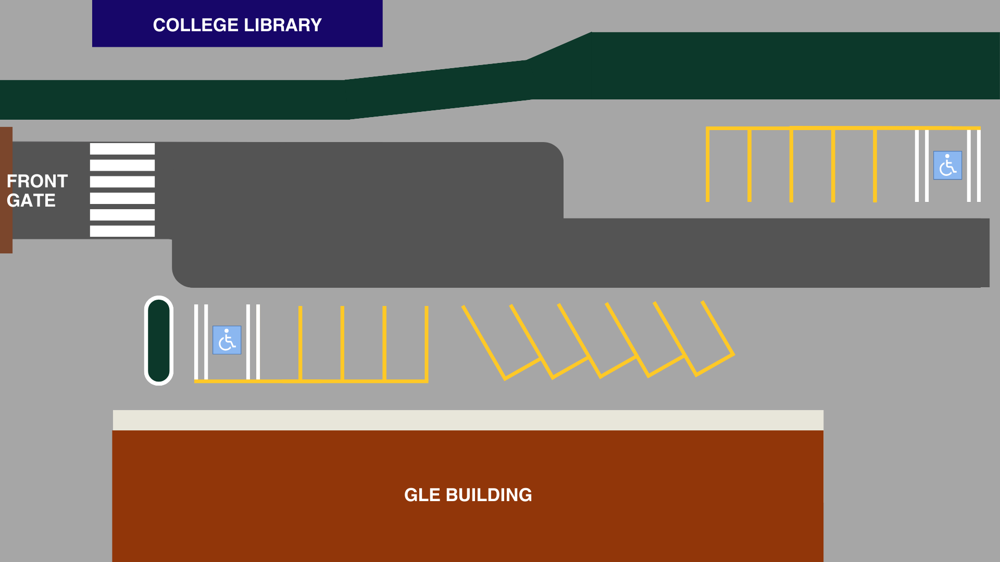

# CIT-U Smart Parking Slot Detection & Monitoring System

A Python-based real-time parking occupancy monitoring application and computer vision controller developed at **Cebu Institute of Technology – University (CIT-U)**. 

This project integrates **OpenCV**, **YOLOv5 object detection**, and a custom **CustomTkinter** desktop dashboard to monitor campus parking zones, track live slot availability, and visualize angled parking bay occupancy in real time.



---

## Key Technical Features

- **Real-Time Occupancy State Management:** Tracks available parking slots dynamically (`A–E` and `1–9`) using reactive state callbacks (`StringVar` trace listeners) that automatically compute capacity thresholds and update visual status indicators (Available / Limited / Full).
- **2D Polygon Rotational Geometry:** Implements custom centroid-based rotational transformation (`math.cos` / `math.sin` vertex mapping) to accurately render and toggle angled parking bays (`-30°` orientation for slots `5–9`) on the monitoring canvas.
- **YOLOv5 Computer Vision Subprocess Pipeline:** Launches, manages, and gracefully terminates external YOLOv5 object detection inference (`detect.py` with custom trained weights `last.pt`) via `subprocess.Popen` without freezing the main UI event loop.
- **Multi-Backend Camera Calibration Utility:** Includes a diagnostic hardware script (`camera_diagnostics.py`) that automatically probes multiple video capture backends (`CAP_DSHOW`, `CAP_MSMF`, `CAP_V4L2`) and renders RGB-converted frame captures via `matplotlib` to ensure reliable camera initialization across Windows and Linux edge devices.
- **Multi-Zone Campus Navigation UI:** Built with `CustomTkinter` and `Pillow (PIL)`, designed for monitoring key CIT-U campus zones (*GLE Building, Near Canteen, JHS Grounds, RTL Building, Allied*).

---

## Project Structure

```text
citu-smart-parking-monitor/
├── assets/
│   ├── logo.png                  # Application icon & branding
│   └── parkinglot.png            # Aerial reference view of the monitored parking zone
├── src/
│   ├── parking_monitor_app.py    # Main interactive dashboard with slot geometry & YOLOv5 process control
│   ├── video_dashboard_ui.py     # Live OpenCV webcam stream & dashboard variant
│   └── camera_diagnostics.py     # Multi-backend OpenCV camera initialization & frame verification utility
├── requirements.txt              # Python dependencies
└── README.md                     # Project documentation
```

---

## Tech Stack

- **Language:** Python 3.x
- **Computer Vision & Image Processing:** OpenCV (`cv2`), YOLOv5 (PyTorch), Pillow (`PIL`)
- **Data & Visualization:** Matplotlib (`pyplot`), Standard `math` & `datetime` modules
- **GUI & Event Loop Architecture:** CustomTkinter (`customtkinter`), Tkinter Canvas & Reactive Variables (`StringVar`)
- **System Integration:** `subprocess`, `sys`, `pathlib`

---

## How It Works

### 1. Rotational Geometry for Angled Parking Bays
Standard bounding boxes only align with horizontal or vertical axes. Because parking slots `5` through `9` are angled at `-30°`, the system computes the polygon centroid `(cx, cy)` of each bay and applies a 2D rotation matrix to each vertex:

```python
def rotate_polygon(vertices, angle):
    cx = sum(x for x, y in vertices) / len(vertices)
    cy = sum(y for x, y in vertices) / len(vertices)
    rotated_vertices = []
    for x, y in vertices:
        tx, ty = x - cx, y - cy
        rx = tx * math.cos(math.radians(angle)) - ty * math.sin(math.radians(angle))
        ry = tx * math.sin(math.radians(angle)) + ty * math.cos(math.radians(angle))
        rotated_vertices.append((rx + cx, ry + cy))
    return rotated_vertices
```

### 2. Multi-Backend Camera Initialization
To prevent camera index failures across different operating systems and USB capture devices, the diagnostic tool iterates through DirectShow, Media Foundation, and Video4Linux2 backends automatically:

```python
def initialize_camera(index=0):
    backends = [cv2.CAP_DSHOW, cv2.CAP_MSMF, cv2.CAP_V4L2]
    for backend in backends:
        cap = cv2.VideoCapture(index, backend)
        if cap.isOpened():
            return cap
    raise ValueError(f"Failed to open camera {index} with any backend")
```

### 3. Non-Blocking YOLOv5 Inference Control
The operator can toggle raw YOLOv5 inference directly from the dashboard. Using `subprocess.Popen`, the detection script runs asynchronously alongside the GUI and can be terminated cleanly on demand.

---

## Setup & Installation

1. **Clone the repository:**
   ```bash
   git clone https://github.com/<your-username>/citu-smart-parking-monitor.git
   cd citu-smart-parking-monitor
   ```

2. **Install dependencies:**
   ```bash
   pip install -r requirements.txt
   ```

3. **Run the camera diagnostic utility:**
   ```bash
   python src/camera_diagnostics.py
   ```

4. **Launch the monitoring dashboard:**
   ```bash
   python src/parking_monitor_app.py
   ```

---

## Author

**Jean Roy Lastimosa**  
B.S. in Electronics Engineering — Cebu Institute of Technology – University (CIT-U)  
📧 lastimosajeanroy@gmail.com | 📍 Cebu, Philippines
